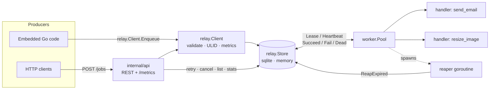
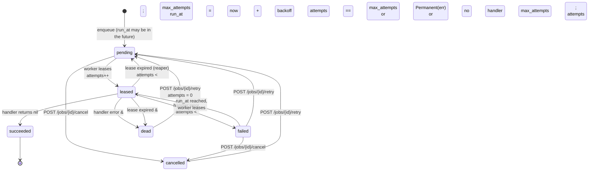

# relay

[](https://github.com/sumit-do/relay/actions/workflows/ci.yml)
[](https://github.com/sumit-do/relay/releases/latest)
[](https://pkg.go.dev/github.com/sumit-do/relay)

[](LICENSE)

**relay** is a durable background job queue for Go with a worker pool, leases,
retries with exponential backoff, dead-lettering and a small REST API. It is a
single static binary backed by SQLite (pure Go, no cgo), and it is also a
library you can embed in your own service.

- **Durable** – jobs live in SQLite (WAL mode) and survive restarts; an
  in-memory store is included for tests and development.
- **At-least-once** – workers *lease* jobs with a visibility timeout and
  heartbeat long-running ones; expired leases are returned to the queue.
- **Retries that behave** – exponential backoff with jitter, configurable per
  queue; exhausted jobs land in a dead-letter state you can inspect and redrive.
- **Operable** – structured logs (`log/slog`), Prometheus metrics, health
  endpoint, graceful drain on `SIGTERM`.
- **Small** – one third-party dependency (the SQLite driver). IDs, metrics and
  backoff are hand-rolled and tested.

## Architecture



The core types are intentionally small:

| Package | Role |
|---|---|
| `relay` | `Job` model, `Status` state machine, `Store` interface, `Client` (producer side), `Metrics` bundle |
| `store/sqlite` | Durable `Store` on SQLite via `modernc.org/sqlite` (pure Go) |
| `store/memory` | In-memory `Store` for tests and local development |
| `storetest` | Contract test suite every `Store` must pass |
| `worker` | `Pool`: per-queue concurrency, heartbeats, backoff, panic recovery, graceful drain |
| `metrics` | Dependency-free Prometheus counters and histograms |
| `clock` | Injectable clock (`Real`, `Fake`) for deterministic tests |
| `internal/api` | HTTP handlers (Go 1.22 `ServeMux` patterns) |
| `internal/id` | ULID-style, monotonic, time-sortable ids |
| `cmd/relay` | The `relay serve` binary (API + workers in one process) |
| `examples/worker` | Embedding the library with custom handlers |

### Job state machine



`succeeded`, `dead` and `cancelled` are terminal for the workers; only an
explicit redrive moves a job out of `dead` or `cancelled`.

## Install

Download a prebuilt binary for Linux, macOS or Windows from the
[latest release](https://github.com/sumit-do/relay/releases/latest), or build from source:

```sh
go install github.com/sumit-do/relay/cmd/relay@latest
relay version
```

## Quick start

```bash
# Run the API and workers together against ./relay.db
go run ./cmd/relay serve --db relay.db --addr :8080 --concurrency 8

# ...or with Docker (database persisted in the relay-data volume)
make docker && make docker-run
```

Enqueue a job and watch it run (the server ships with `noop`, `sleep` and
`fail` demo handlers):

```bash
curl -s -X POST localhost:8080/jobs \
  -d '{"type":"sleep","queue":"default","payload":{"ms":500},"priority":5,"max_attempts":3}'
# {"id":"01M5XZ97W66XMP6XKAFSYM2WFS","status":"pending", ...}

curl -s localhost:8080/jobs/01M5XZ97W66XMP6XKAFSYM2WFS
# {"status":"succeeded","attempts":1,"completed_at":"...", ...}

# Idempotent enqueue: same key returns the same job with HTTP 200 (201 on first create)
curl -s -X POST localhost:8080/jobs -d '{"type":"noop","idempotency_key":"order-42"}'

# Delayed job
curl -s -X POST localhost:8080/jobs -d '{"type":"noop","delay":"10m"}'

# Watch a job exhaust its retries and dead-letter, then redrive it
curl -s -X POST localhost:8080/jobs -d '{"type":"fail","max_attempts":2}'
curl -s 'localhost:8080/jobs?status=dead'
curl -s -X POST localhost:8080/jobs/<id>/retry

curl -s localhost:8080/queues
curl -s localhost:8080/metrics
```

### Embedding the library

```go
store, _ := sqlite.Open("relay.db")
defer store.Close()

pool := worker.New(store, worker.Config{Concurrency: 4, LeaseDuration: 30 * time.Second})
pool.AddQueue(worker.QueueConfig{Name: "email", Concurrency: 8,
    Backoff: &worker.Backoff{Base: 2 * time.Second, Max: 5 * time.Minute, Factor: 2, Jitter: 0.3}})

pool.Handle("send_email", func(ctx context.Context, job *relay.Job) error {
    var p struct{ To string `json:"to"` }
    if err := json.Unmarshal(job.Payload, &p); err != nil {
        return worker.Permanent(err) // never retry malformed payloads
    }
    return smtp.Send(ctx, p.To)       // any other error is retried with backoff
})

client := relay.NewClient(store)
client.Enqueue(ctx, relay.EnqueueRequest{Queue: "email", Type: "send_email",
    Payload: json.RawMessage(`{"to":"ada@example.com"}`), IdempotencyKey: "welcome-ada"})

pool.Run(ctx) // blocks until ctx is cancelled, then drains in-flight jobs
```

See [`examples/worker/main.go`](examples/worker/main.go) for the full program.

## HTTP API

All bodies are JSON. Errors are `{"error": "..."}`.

| Method | Path | Description | Responses |
|---|---|---|---|
| `POST` | `/jobs` | Enqueue. Body: `{"type","queue?","payload?","priority?","max_attempts?","run_at?"\|"delay?","idempotency_key?"}` | `201` created, `200` idempotent hit, `400` invalid |
| `GET` | `/jobs/{id}` | Fetch a job | `200`, `404` |
| `GET` | `/jobs?queue=&status=&type=&limit=` | List jobs, newest first (`limit` ≤ 1000, default 100) | `200 {"jobs":[...]}`, `400` |
| `POST` | `/jobs/{id}/retry` | Redrive a `dead`, `failed` or `cancelled` job: `pending`, `attempts=0`, `run_at=now` | `200`, `404`, `409` wrong state |
| `POST` | `/jobs/{id}/cancel` | Cancel a `pending` or `failed` job | `200`, `404`, `409` wrong state |
| `GET` | `/queues` | Per-queue counts by status | `200 {"queues":[{"name","counts":{...},"total"}]}` |
| `GET` | `/healthz` | Liveness/readiness (pings the store) | `200`, `503` |
| `GET` | `/metrics` | Prometheus text format | `200` |

`delay` is a Go duration string (`"30s"`, `"5m"`); `run_at` is RFC 3339. They are
mutually exclusive. `queue` defaults to `default`, `max_attempts` to `10`.

### Metrics

| Metric | Type | Labels | Meaning |
|---|---|---|---|
| `jobs_enqueued_total` | counter | `queue` | jobs accepted (idempotent duplicates excluded) |
| `jobs_succeeded_total` | counter | `queue` | attempts that returned nil |
| `jobs_failed_total` | counter | `queue` | attempts that returned an error or panicked |
| `jobs_dead_total` | counter | `queue` | jobs moved to dead-letter |
| `job_duration_seconds` | histogram | `queue`, `type` | handler wall time |

## Delivery semantics

relay provides **at-least-once** delivery. Make handlers idempotent.

1. **Leases, not locks.** `Store.Lease` atomically picks the best ready job
   (`priority DESC, run_at ASC, id ASC`), marks it `leased`, increments
   `attempts` and stamps `lease_expires_at = now + LeaseDuration` together with
   a random lease token. In SQLite this is a single-connection transaction; in
   memory it is a mutex.
2. **Heartbeats.** While a handler runs, the pool extends the lease every
   `LeaseDuration/3`. A handler may run far longer than the lease as long as
   the process is alive.
3. **Expiry and reaping.** If a worker dies, its leases expire. A reaper
   goroutine periodically runs `ReapExpired`, returning expired jobs to
   `pending` (or `dead` if the lost attempt was the last one). The job is then
   picked up by another worker, so **a crashed handler's side effects may be
   repeated**.
4. **Fencing.** Every completion call (`Succeed`, `Fail`, `Dead`, `Heartbeat`)
   carries the lease token. A stale worker that comes back after its lease was
   reaped gets `ErrLeaseLost` and cannot overwrite the newer attempt. If a
   heartbeat reports a lost lease, the handler's `ctx` is cancelled.
5. **Retries.** On error the job becomes `failed` with
   `run_at = now + Backoff.Delay(attempts)`; `failed` jobs are leasable once
   `run_at` passes. `Backoff.Delay = min(Max, Base·Factor^(attempt-1)) · (1 ± Jitter·U)`.
   After `max_attempts` failures (or a `worker.Permanent` error, or a panic on
   the final attempt) the job is `dead` and stays there until redriven.
6. **Panics** inside a handler are recovered and recorded as a failed attempt
   with the stack trace in `last_error`; the worker goroutine survives.
7. **Graceful shutdown.** On `SIGINT`/`SIGTERM` the HTTP server stops
   accepting requests, workers stop leasing, and the pool waits up to
   `DrainTimeout` for in-flight handlers. After the deadline, handler contexts
   are cancelled; an interrupted attempt is recorded as `failed` and retried
   later, so nothing is lost.
8. **Idempotent enqueue.** `idempotency_key` is globally unique; a second
   enqueue with the same key returns the original job and writes nothing.

What relay does **not** give you: exactly-once execution, cross-queue
ordering guarantees, or FIFO within a priority band under concurrency (jobs are
*started* in order, but may finish in any order).

## Configuration

`relay serve` flags (each has an environment-variable fallback):

| Flag | Env | Default | Description |
|---|---|---|---|
| `--db` | `RELAY_DB` | `relay.db` | SQLite path; `:memory:` for ephemeral |
| `--addr` | `RELAY_ADDR` | `:8080` | HTTP listen address |
| `--concurrency` | `RELAY_CONCURRENCY` | `8` | Default handlers per queue |
| `--queues` | `RELAY_QUEUES` | `default` | Queues to work, e.g. `default,mail=4,images=2` |
| `--lease` | `RELAY_LEASE` | `30s` | Visibility timeout per attempt (heartbeat every third) |
| `--poll` | `RELAY_POLL` | `500ms` | Idle poll interval |
| `--drain` | `RELAY_DRAIN` | `30s` | Graceful shutdown timeout |
| `--backoff-base` | `RELAY_BACKOFF_BASE` | `1s` | First retry delay |
| `--backoff-max` | `RELAY_BACKOFF_MAX` | `10m` | Cap on retry delay |
| `--workers` | `RELAY_WORKERS` | `true` | `false` runs the API only |
| `--log-format` | `RELAY_LOG_FORMAT` | `text` | `text` or `json` |
| `--log-level` | `RELAY_LOG_LEVEL` | `info` | `debug`, `info`, `warn`, `error` |

Library users configure the same knobs through `worker.Config` and
`worker.QueueConfig` (per-queue `Concurrency`, `LeaseDuration`, `Backoff`).

## Development

```bash
make test     # go test -race ./...
make lint     # gofmt + go vet
make build    # static binary in ./bin/relay
make run      # serve against ./relay.db
make example  # run examples/worker
```

Store backends are verified by a shared contract suite
(`storetest.Run`), so adding a backend (Postgres, say) means implementing
`relay.Store` and adding a three-line test. Worker tests use `clock.Fake` to
drive lease expiry, backoff schedules and dead-lettering deterministically
without sleeping through real timeouts.

## Design decisions

- **SQLite with a single connection.** `modernc.org/sqlite` keeps the binary
  cgo-free and statically linked. Limiting `database/sql` to one connection
  makes the lease transaction trivially serialisable and sidesteps
  `SQLITE_BUSY` handling; SQLite serialises writers anyway, and WAL mode keeps
  reads cheap. Throughput is bounded by fsync, which is fine for the
  "one node, thousands of jobs a minute" niche this targets.
- **Time is always passed in.** No store method calls `time.Now()`. The pool
  and API take a `clock.Clock`, which is what makes the worker tests
  deterministic and fast.
- **Attempts are counted at lease time**, not at failure time. That makes a
  crash during an attempt count against `max_attempts`, so a poison job that
  kills its worker still ends up dead-lettered instead of looping forever.
- **`failed` is a distinct status** from `pending` even though both are
  leasable. Operators can list "jobs currently in retry backoff" and see
  `last_error` without digging through logs.
- **Lease tokens fence stale workers.** A random token per lease is cheaper
  and more robust than comparing timestamps, and it lets the pool cancel a
  handler the moment a heartbeat discovers the lease is gone.
- **Hand-rolled ULIDs and metrics.** Both are small, well-specified, and
  dropping two dependencies keeps the module graph to one external package.
- **Go 1.22 `ServeMux` patterns** instead of a router dependency; method and
  path matching are built in now.
- **`cancelled` is an extra status** beyond the classic five so that cancelling
  is reversible (`retry` works on it) and distinguishable from `dead`.

## Roadmap

- [ ] Postgres `Store` using `SELECT ... FOR UPDATE SKIP LOCKED`
- [ ] Unique/cron-style recurring jobs
- [ ] Batch enqueue endpoint and bulk redrive (`POST /queues/{name}/redrive`)
- [ ] Per-queue rate limiting and pause/resume
- [ ] Job result storage and `GET /jobs/{id}/result`
- [ ] Web UI for queues and dead letters
- [ ] OpenTelemetry tracing around handler execution
- [ ] Retention policy: purge succeeded jobs older than N days

## License

MIT © 2026 Sumit Singh. See [LICENSE](LICENSE).
